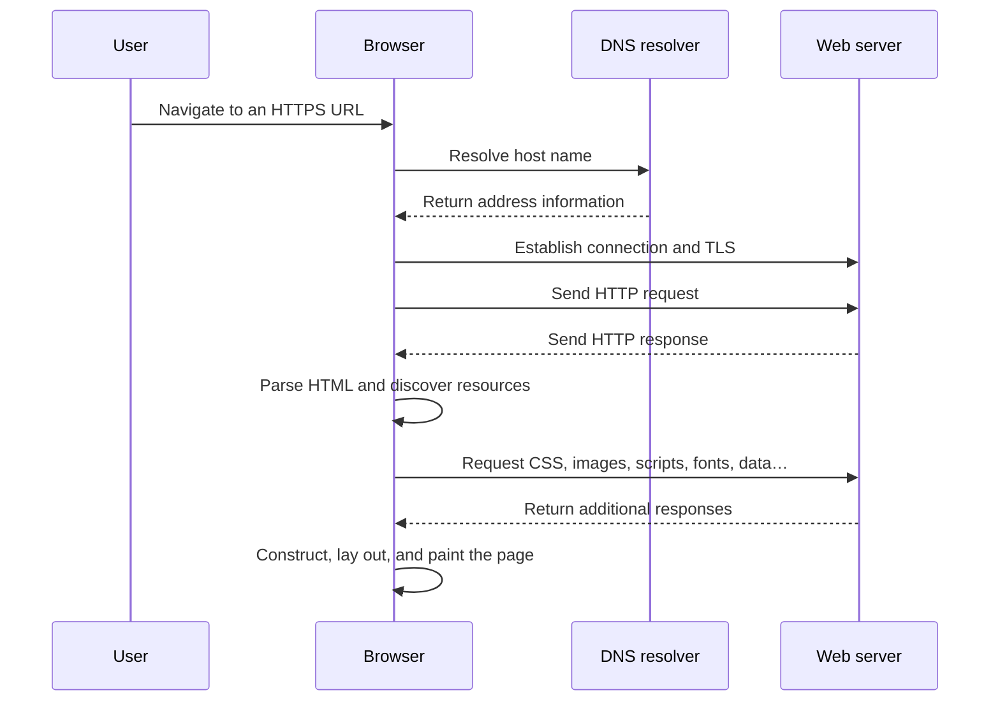

# Session 1 — How the Web Works

> **Essential question:** What actually happens between entering a Uniform
> Resource Locator (URL) and seeing
> a page, and how can a developer observe each step?

## Session map

Table 1.1 gives instructors and students a shared view of the session before the
technical discussion begins.

**Table 1.1 - Session scope, preparation, and evidence**

| Item | Details |
|---|---|
| Audience | Students with programming experience but no assumed web knowledge |
| Preparation | Complete the workstation orientation and bring its readiness record |
| Contact time | 100-minute concept workshop plus a 110-minute laboratory |
| Independent work | Approximately 2–3 hours |
| Main artifact | A small Campus Hub page served locally and recorded in Git |
| Assessment | Network observation, repository history, exercises, and quiz |

## Learning outcomes

After this session, you should be able to:

1. Distinguish the Internet, the World Wide Web, a browser, a server, a website,
   a web page, and a resource.
2. Decompose a Hypertext Transfer Protocol Secure (HTTPS) URL into scheme, host,
   port, path, query, and fragment.
3. Read the structure and notation of Internet Protocol version 4 (IPv4) and
   Internet Protocol version 6 (IPv6) addresses, including prefix lengths.
4. Trace a simplified navigation through name resolution, connection setup, a
   Hypertext Transfer Protocol (HTTP) request, an HTTP response, and browser
   processing.
5. Read the method, target, status, and selected headers of an HTTP exchange.
6. Explain why `localhost`, a local file, and a public deployment are different.
7. Create a minimal valid HyperText Markup Language (HTML) document and serve it
   through HTTP.
8. Use browser developer tools to collect evidence instead of guessing.
9. Create a Git repository and make small, meaningful commits.

## 1. Begin with evidence

This session assumes that you have completed **Prepare Your Web-Programming
Workstation**, the orientation immediately before this chapter. That orientation
does more than list software: it explains what each tool is for, gives
operating-system-specific installation steps, verifies the versions, starts a
local server, opens browser developer tools, runs the automated checks, and
records a first Git commit. If any of those steps is unfamiliar or fails, return
to the orientation before continuing. The chapters deliberately reuse that same
editor-terminal-browser-test-Git loop so that learning the subject is not
confused with repeatedly changing tools.

Open a familiar website. Before reading further, write a short prediction:

- Is the page already stored on your computer?
- How does the browser find the correct machine?
- Does one page require one request?
- Which computer executes the HTML?
- Can the server see the `#fragment` portion of a URL?

Do not correct the prediction yet. At the end of the session, annotate it with
what changed. Learning starts when a mental model becomes testable.

Keep two columns in your notes: **observation** and **interpretation**. “The
Network panel shows status 404” is an observation. “The server has no matching
route for this path” is an interpretation that the evidence may support. This
habit prevents a plausible explanation from being mistaken for a measured fact.

## 2. Internet is not the Web

The **Internet** is a network of networks that uses a family of protocols to move
data between machines. The **World Wide Web** is one application built on that
network. Email, voice calls, online games, and the Web can all use the Internet,
but they are not all the Web.

This distinction matters because a web developer works with several layers at
once. A failure in the network layer is different from a failure in HTTP, and
both are different from an error in an HTML document. When every failure is
called “the website is down,” diagnosis becomes guesswork. Professional practice
begins by naming the layer in which the evidence points. Figure 1.1 separates the
Internet infrastructure from the Web application built on top of it.

<!-- figure:web-layers -->

Figure 1.2 offers a more concrete view of the same idea. The
laptop, Wi-Fi router, intermediate network devices, naming service, security
step, and data-center server are not one giant machine. They are separate parts
that cooperate. The dotted return path represents response data travelling back
to the browser; the browser must still interpret that data before a page appears.

<!-- illustration:web-request-journey -->

### 2.1 What is a network?

A **network** is a group of computing devices that can exchange data. Your home
Wi-Fi network is one example. A university network is another. The Internet
connects an enormous number of independently operated networks through common
protocols. No single organization owns every cable, router, address, or service.

A device joins a network through a **network interface**, such as a Wi-Fi radio
or an Ethernet adapter. A direct connection between interfaces is a **link**.
Within a local network, a switch commonly forwards frames between wired devices,
and a wireless access point connects radio devices to that local infrastructure.
A **router** connects different networks and decides where an Internet Protocol
packet should be forwarded next. These devices cooperate, but they do not all do
the same job.

Data is normally divided into manageable units often called **packets**. Routers
forward packets toward their destinations. Different packets belonging to the
same exchange may encounter different delays, and networks can lose, duplicate,
or reorder them. Higher layers compensate according to the service they promise.

Two everyday measurements are easy to confuse. **Bandwidth** describes how much
data a path can carry per unit of time; **latency** describes how long data takes
to travel and receive a response. A high-bandwidth connection can still feel
slow when latency is high, and a low-bandwidth link can transfer a tiny message
quickly while struggling with a large video.

An **Internet Protocol (IP) address** identifies a network interface for Internet
Protocol delivery. Internet Protocol version 4 (IPv4) addresses are commonly
written as four decimal numbers, such as
`192.0.2.10`; Internet Protocol version 6 (IPv6) addresses use a larger
hexadecimal notation, such as
`2001:db8::10`. These examples come from ranges reserved for documentation. An IP
address is not the same thing as a domain name, a URL, a person, or necessarily a
single physical computer. Cloud services, proxies, load balancers, and shared
hosting make one-to-one assumptions unreliable.

Many home and campus networks use private IPv4 addresses internally and share a
public address through **Network Address Translation (NAT)** at a router. NAT is
common, but it is not the definition of routing and it is not required for every
network design. IPv6 provides a much larger address space; its deployment and
privacy mechanisms are more nuanced than the claim that it “removes routers.”

### 2.2 Clients and servers are roles

A **client** initiates a request for a service. A **server** listens for requests
and produces responses. These are roles, not permanent categories of hardware. A
laptop can run a browser as a client and a development server at the same time.

A **host** is a machine or virtual environment participating in a network; a
**process** is a running program on that host. One host can run a browser process,
a development-server process, a database process, and many unrelated programs at
the same time. Ports help the operating system deliver arriving transport data
to the intended process.

The word *server* is used in two related senses:

- a server **program**, such as a process listening for Hypertext Transfer
  Protocol (HTTP) requests; and
- a server **machine**, meaning a computer that runs one or more server programs.

Keep the two meanings separate. “The server returned `404`” describes program
behavior. “The server lost power” describes a machine or infrastructure failure.

A **browser** is a client application that understands web standards. A **web
page** is normally a HyperText Markup Language (HTML) document. A **website** is
a related collection of pages and other resources. A **resource** is anything
identified on the Web:
HTML, Cascading Style Sheets (CSS), an image, a font, JavaScript Object Notation
(JSON) data, a generated report, or another result.

Client and server do not mean “weak computer” and “powerful computer,” nor are
they permanent identities. A server handling the browser's request may become a
client when it requests data from another service. Likewise, the same laptop can
run both sides during development. The role is defined by the exchange being
described.

Figure 1.3 makes the change of role visible. The application server is a server in
relation to the browser because it receives the browser's HTTP request and sends
an HTTP response. When that same application process asks a database service for
data, it initiates a new exchange and therefore acts as a client. The database
server answers that second exchange. The labels describe each relationship; they
do not assign one permanent identity to the machines.

<!-- media:client-server-software-roles -->

### 2.3 HTML, CSS, and JavaScript have different jobs

Someone completely new to the Web often hears these three names together and
assumes they are interchangeable programming languages. They are not.

**HTML**, or **HyperText Markup Language**, describes the structure and meaning
of a document. “Hypertext” means that documents can link to other resources.
“Markup” means that text is annotated with elements such as headings, paragraphs,
links, images, lists, and forms. HTML is not primarily a language for writing
algorithms. It describes what the parts of a document are.

**CSS**, or **Cascading Style Sheets**, describes presentation: typography,
color, spacing, layout, responsive behavior, and other aspects of rendering. The
word “cascading” refers to the rule system that combines declarations from
different sources and resolves conflicts. CSS is much more than decoration; it
controls layout across screens, print, different writing systems, user
preferences, and accessibility needs.

**JavaScript** is a programming language. In a browser it can respond to events,
calculate values, request data, update the document, and use browser-provided
interfaces. JavaScript can also run outside browsers, including on servers
through environments such as Node.js.

Despite the similar names, JavaScript and Java are different programming
languages with different type systems, execution environments, and common uses.
Modern JavaScript follows a language specification named **ECMAScript**. A
JavaScript engine implements that language, while the surrounding runtime adds
facilities that are not part of the language itself. A browser supplies the DOM,
events, and Web APIs. Node.js supplies facilities for files, processes, network
servers, and command-line programs. That is why a function or array works in
both environments while `document` normally exists only in a browser.

This course uses modern JavaScript as its primary programming language on both
sides of the HTTP boundary. It teaches the sides separately before integrating
them. Students first learn language fundamentals, then browser programming with
the DOM and events, asynchronous requests, and modules. They later apply the same
language through Node.js to server routes and data access. Sharing a language
does not erase the boundary: browser code runs on a user's device and cannot be
trusted to enforce server rules; server code runs under the application's control
and must validate every request. TypeScript is introduced only after JavaScript
and modules are understood.

Think of one event page. HTML says, “This is the main heading; this is the event
date; this is a registration button.” CSS says, “Use this type scale, keep the
text readable, and arrange the event cards according to the available width.”
JavaScript may say, “When the student activates the filter, request the matching
events and update the results without replacing the whole page.” The three
technologies address different questions about the same interface.

The browser does not execute HTML as an algorithm. It parses HTML into the
**Document Object Model (DOM)**, an in-memory tree representing the live
document. CSS rules match parts of that tree and contribute presentation. A
browser's JavaScript engine executes JavaScript, which can read or change the DOM
through browser interfaces. Later chapters examine these mechanisms separately;
for now, the important boundary is meaning, presentation, and behavior.

Table 1.2 distinguishes the three technologies by responsibility rather than by
the file extensions in which students happen to encounter them.

**Table 1.2 - Responsibilities of the core browser technologies**

| Technology | Primary responsibility | Simple example |
|---|---|---|
| HTML | Structure and meaning | “This text is the page's main heading.” |
| CSS | Presentation and layout | “Place these cards in a responsive grid.” |
| JavaScript | Behavior and state | “When the user submits, validate and update the page.” |

Figure 1.4 shows the same page in three stages. Read it from left to right: a plain
but meaningful document, the same document with professional presentation, and
the same presented document after an interaction changes its state.

<!-- media:html-css-javascript-jobs -->

This separation is a design principle, not an absolute physical boundary. A
JavaScript program can create HTML elements, and modern CSS can react to many
conditions. Nevertheless, asking whether a concern is structural, presentational,
or behavioral usually leads to clearer code.

The separation also improves resilience. If a stylesheet fails to load, a sound
HTML document can still expose its headings, links, and form controls, although
it will look plain. If optional JavaScript fails, ordinary navigation and a
server-backed form can often remain useful when the page was designed with
**progressive enhancement**. This does not mean that every application can work
without JavaScript; it means that essential tasks should depend on no more
technology than they genuinely require.

### 2.4 Website, web application, and API

A **website** commonly emphasizes documents and navigation. A **web application**
usually emphasizes user interaction and changing state. The boundary is not a
standardized technical line: a university portal may contain articles, search,
forms, dashboards, and real-time notifications in one system.

These terms describe an emphasis, not three incompatible technologies. A news
site can include interactive search. A web application can contain long-form
documentation. Both can use the same URLs, HTTP semantics, HTML, CSS, JavaScript,
authentication system, and server infrastructure.

An **API**, or **Application Programming Interface**, is a defined way for
software components to communicate. A web API often accepts HTTP requests and
returns JSON rather than a complete HTML document. A browser interface and an API
can be two views of the same underlying application.

An API is a contract, not a database made public and not necessarily a screen a
person visits. The contract defines operations, inputs, outputs, errors, and
rules. For Campus Hub, public event pages could emphasize reading and navigation;
an organizer dashboard could emphasize editing and changing state; and an API
could provide event data to that dashboard, a mobile client, or another
university service. The server may obtain the information from a database, but
the API stands between clients and that internal storage.

Figure 1.5 uses three panels to compare those emphases. The left panel represents
linked documents, the center represents an interface with interactive state, and
the right represents structured exchanges between software clients and a
service. The shared infrastructure beneath them emphasizes that one production
system can provide all three.

<!-- media:website-webapp-api -->

Whether the response is HTML or JSON does not decide who may access it. APIs
still require validation, authorization, rate control, error handling, and
careful privacy boundaries. Later chapters develop those responsibilities after
students can first observe the underlying HTTP exchanges.

### Checkpoint 1 — classify the roles

When your browser requests `http://localhost:8000/index.html`, which statements
are true?

1. Your computer is both client host and server host.
2. The browser and server are the same program.
3. The exchange can use HTTP even though no packet leaves your computer.
4. `localhost` means “the instructor's server.”

**Answer:** 1 and 3. Client and server describe software roles. `localhost`
normally resolves to the loopback interface of the machine on which the browser
runs.

## 3. Read a URL as structured data

A Uniform Resource Locator (URL) is the address-like identifier a browser uses to
refer to a resource and determine how to access it. It is not an informal label or
a sentence. It is serialized data with a defined grammar, which is why characters
such as `:`, `/`, `?`, `&`, and `#` have precise roles in particular positions.
Reading a URL by components is the first step toward explaining navigation,
security boundaries, routing, caching, and form submission without guesswork.

Consider the following URL.

```text
https://events.campus.example:8443/clubs/robotics?semester=fall&limit=20#schedule
\___/   \_____________________/ \__/\______________/ \____________________/ \______/
scheme             host        port       path                query          fragment
```

Figure 1.6 turns the same URL into labelled components so that each punctuation
mark and substring can be discussed independently.

<!-- figure:url-anatomy -->

Table 1.3 explains what each labelled URL component contributes.

**Table 1.3 - Components of a URL and their purposes**

| Component | Purpose |
|---|---|
| Scheme | Identifies how the URL should be handled; `https` uses HTTP with transport security. |
| Host | Identifies the network host. A domain name can be resolved to an IP address. |
| Port | Selects a service endpoint on the host. It is often omitted when the default applies. |
| Path | Identifies a resource within the server's naming space; the resource does not have to be a physical file. |
| Query | Supplies additional parameters. Its meaning belongs to the application. |
| Fragment | Identifies a secondary location or state within the retrieved resource. It is handled by the client and is not sent in the HTTP request. |

For HTTPS, the conventional default port is 443; for HTTP it is 80. A URL can omit
the port without omitting the concept: the scheme supplies the default.

### A note about the colon character

The colon has no single universal meaning. Its meaning comes from the notation in
which it appears. In `https://`, the colon ends the URL scheme. In
`campus.example:8443`, it separates the host from an explicitly written port. In the
IPv6 address `2001:db8::10`, colons separate groups of hexadecimal digits, and the
double colon compresses one run of zero groups. In ordinary prose, a colon may
simply introduce an explanation or list. Code formatting in this book marks URL
and address examples so that punctuation belonging to the technical value is
easier to distinguish from punctuation in the surrounding sentence.

### 3.1 A path is a name, not necessarily a disk location

Early websites often mapped `/notes/week1.html` directly to a file named
`week1.html`. That mapping remains possible, but modern servers frequently use a
**router**. A path such as `/students/42` may instruct an application to retrieve
student 42 from a database and generate a response. The client cannot determine
from the URL alone whether a file, database query, cache entry, function, or
another service produced the representation.

### 3.2 Query data and fragments

A query begins with `?`. Multiple name-value pairs are commonly separated with
`&`, although an application's interpretation depends on its contract. Query
parameters are appropriate for concerns such as filtering, sorting, search, and
pagination when those choices belong in a shareable URL.

Queries are not private. They may appear in browser history, server logs,
analytics systems, copied links, and intermediary records. Never put passwords,
session identifiers, or other secrets in a URL.

A fragment begins with `#`. The browser retains it rather than including it in
the HTTP request target. In a traditional document it can identify an element
whose `id` matches the fragment. Client-side applications can assign other local
meanings to fragments. A fragment is still not a secure storage location: browser
history, screenshots, extensions, and client-side scripts may expose it.

### 3.3 Origin and same-origin reasoning

Suppose the browser has loaded the Campus Hub events page from the following
URL.

> **This is a fictional address, not a website to open.** The ending
> `.example` is reserved for names used in teaching and documentation. Therefore,
> `hub.campus.example` intentionally has no public Campus Hub server behind it.
> Some PDF viewers and browsers automatically make printed URL-shaped text look
> clickable. If you follow this example address, a message such as
> `DNS_PROBE_FINISHED_NXDOMAIN` is expected: it means the Domain Name System (DNS)
> could not find that fictional name. When a later activity expects you to open
> a working page, the book explicitly gives a `localhost` address or a verified
> public link.

```text
https://hub.campus.example/events
```

The complete URL identifies a resource, but the browser also needs a stable way
to answer a security question: *Which other documents and services belong to the
same source as this page?* The browser answers that question by calculating the
page's **origin**.

For an ordinary HTTP or HTTPS URL, an origin contains exactly three values:

1. the **scheme**, such as `http` or `https`;
2. the **hostname**, such as `hub.campus.example`; and
3. the **effective port**, such as `443` for HTTPS.

The word *effective* matters. A URL does not have to show a port explicitly.
HTTPS uses port 443 by default, while HTTP uses port 80 by default. Consequently,
`https://hub.campus.example` and `https://hub.campus.example:443` have the same origin.
The first URL omits the port from its spelling, but its effective port is still
443.

For the Campus Hub page, the origin can therefore be written as follows.

```text
https://hub.campus.example
```

Notice what disappeared. The path `/events` is not part of the origin. Neither
is a query nor a fragment. Figure 1.6 labels all of those URL components; when
you make an origin comparison, use only the scheme, hostname, and effective
port. Paths still distinguish resources, but they do not create different
origins.

#### A mechanical way to compare two origins

Do not decide by asking whether two URLs “look related.” Apply the same four
steps every time:

1. Resolve a relative reference, if necessary, so that both values are complete
   URLs.
2. Compare the schemes. If they differ, the origins differ.
3. Compare the hostnames. If they differ, the origins differ.
4. Compare the effective ports, inserting the scheme's default when a port is
   omitted. The URLs are same-origin only if all three comparisons match.

Apply those steps with `https://hub.campus.example/events` as the page URL.

- `https://hub.campus.example/clubs?active=true` is **same-origin**. Only the path
  and query differ.
- `https://hub.campus.example:443/help` is **same-origin**. The written port 443 is
  the default HTTPS port, so both effective ports are 443.
- `http://hub.campus.example/events` is **cross-origin**. The scheme is `http`
  instead of `https`; its default port is also 80 instead of 443.
- `https://api.campus.example/events` is **cross-origin**. `api.campus.example` and
  `hub.campus.example` are different hostnames. Sharing the ending
  `campus.example` does not make them the same origin.
- `https://hub.campus.example:8443/events` is **cross-origin**. The hostname
  matches, but port 8443 does not match the effective port 443.

This rule often surprises students during local development. A page at
`http://localhost:8000` and an application programming interface (API) at
`http://localhost:3000` run on the same computer, but they are cross-origin
because their ports differ. Similarly, `http://localhost:8000` and
`http://127.0.0.1:8000` are cross-origin because `localhost` and `127.0.0.1` are
different host values. “Same machine” and “same origin” answer different
questions.

#### Why the browser needs this boundary

Imagine that a student is signed in to a private Campus Hub page and then opens
an unrelated, malicious page in another tab. If any script could freely read
data from any origin that the browser could reach, the malicious page could try
to read the student's private timetable, grades, or intranet pages. The
**same-origin policy** limits how a document or script from one origin can
interact with resources from another origin. It is one of the browser's central
isolation mechanisms.

The policy is not a rule that says “no cross-origin traffic is ever allowed.”
Browsers commonly allow a user to follow a link to another origin, allow a form
to submit to another origin, and allow a page to display some cross-origin
resources such as images. The important restrictions depend on the kind of
interaction. In particular, JavaScript normally cannot read a cross-origin
`fetch()` response unless the receiving server deliberately permits that access.

**Cross-Origin Resource Sharing (CORS)** is the HTTP mechanism through which a
server can grant selected cross-origin access. CORS does not turn two origins
into one origin, and browser code cannot grant itself permission. The server
states its policy in response headers, and the browser enforces the result.
Chapter 6 develops that request-and-response process in detail.

Also keep **origin** separate from the looser everyday word *website*. One
website may deliberately use several origins, such as `www.campus.example` for
pages and `api.campus.example` for data. Those names may belong to the same
organization, yet the browser still treats them as different origins. Later
security chapters will also distinguish *same-origin* from *same-site*; the two
terms are not interchangeable.

#### Check the rule before moving on

A page is loaded from `http://localhost:8000/week-01/`. Decide whether each
target is same-origin with the page.

- `/images/campus.svg` is same-origin because a relative URL inherits the
  page's scheme, hostname, and port.
- `http://localhost:8000/api/events` is same-origin because all three origin
  values match.
- `http://localhost:3000/api/events` is cross-origin because the port differs.
- `https://localhost:8000/api/events` is cross-origin because the scheme
  differs, even though the hostname and written port match.
- `http://127.0.0.1:8000/api/events` is cross-origin because the host differs,
  even though both names may reach the same computer.

The habit to retain is precise: compare scheme, hostname, and effective port.
Do not compare the path, do not judge by organizational ownership, and do not
substitute “same computer” for “same origin.” Later chapters will connect this
model to cookies, browser storage, iframes, CORS, and content isolation.

### 3.4 Encoding and normalization

URLs are serialized according to defined parsing and percent-encoding rules. A
space may appear as `%20`, and form-encoded query data often represents a space
with `+`. Visually similar or differently encoded URLs are not safe to compare by
casual inspection. Applications should use a standards-compliant URL parser
rather than split URL strings manually.

The left-to-right appearance of a hostname can mislead beginners. In
`accounts.university.example`, the registered-domain boundary depends on naming
policy, but the DNS hierarchy becomes more general toward the right. Never decide
whether a site is trustworthy merely because a familiar word appears somewhere
in the hostname.

### Predict before running

Given this base URL:

```text
https://hub.campus.example/events/today
```

predict the targets of these references:

```text
../clubs
/help
?format=json
#registration
```

**Answers:**

- `../clubs` → `https://hub.campus.example/clubs`
- `/help` → `https://hub.campus.example/help`
- `?format=json` → `https://hub.campus.example/events/today?format=json`
- `#registration` → `https://hub.campus.example/events/today#registration`

Relative URL resolution follows defined rules; it is not plain string
concatenation. A relative reference depends on a base URL. In an HTML document,
that base is normally the document URL unless a `base` element explicitly changes
it. The same text, such as `../clubs`, can therefore identify different targets
when it appears in documents at different locations.

## 4. From navigation to pixels

The following model is intentionally simplified, but each step is observable or
refinable later in the book.

Two abbreviations appear in the sequence. The Domain Name System (DNS) supplies
naming information, and Transport Layer Security (TLS) protects a secure
connection. The sections immediately after the figure explain where these
protocols fit and what they do not do. Figure 1.7 traces the whole page-navigation
sequence before those individual responsibilities are examined.



Figure 1.7 is a sequence diagram: it emphasizes **when** each participant acts and
which participant sends each message. It deliberately hides most of the physical
network so that the causal order remains readable. The browser does not normally
connect to a server by one uninterrupted cable. Its data crosses a succession of
local and remote network links.

Figure 1.8 presents the same navigation from a spatial point of view. A laptop may
send a Wi-Fi frame to an access point; the campus network carries the data through
switches and a router; independently operated transit networks forward IP packets;
and a data-center network finally delivers them to the server. Response data
returns through interconnected networks, although it is not guaranteed to follow
exactly the same route in reverse. Routers forward packets toward addresses; they
do not interpret the page's headings, CSS rules, or JavaScript behavior.

<!-- media:browser-request-across-networks -->

The DNS lookup shown near the beginning is a related exchange, not another cable
inside the page request. It helps the client obtain destination information. Once
the browser has suitable cached or newly resolved address information, it can
establish the connection used for HTTPS. Together, Figures 8 and 9 provide two
complementary views: one explains the order of work, and the other explains where
the data travels.

### 4.0 The protocol stack: cooperation without confusion

The browser does not send one special object called “a website packet.” A page
request is completed by several protocols working together. The word **stack** is
helpful because each layer provides a service to the layer above it and relies on
a service below it. The layers are not a menu from which the browser chooses only
one item.

For one secure page request, several layers are active during the same overall
exchange. The browser may create an HTTP request. Transport Layer Security (TLS)
protects that HTTP data. Transmission Control Protocol (TCP) may carry the
protected bytes reliably. Internet Protocol (IP) addresses and routes packets.
Finally, a link technology such as Wi-Fi or Ethernet moves frames across each
local network connection. A router removes one link-layer frame and constructs a
new one for the next link, while the IP packet continues toward its destination.

Some entries in a stack are alternatives because different protocol versions
solve the same layer's job differently. Hypertext Transfer Protocol version 2
(HTTP/2) commonly uses TLS over TCP. Hypertext Transfer Protocol version 3
(HTTP/3) uses QUIC, a secure transport protocol, over the User Datagram Protocol
(UDP). QUIC includes the security handshake needed by HTTP/3, so an HTTP/3 stack
does not place a separate TLS box below QUIC in the same way as HTTP/2 over TCP.
Both examples still use IP and a link technology.

<!-- figure:protocol-stack -->

Read each column in Figure 1.9 from top to bottom. A column represents one possible
combination used for a page exchange; it does not mean that only one box operates.
The boxes in one column cooperate. The two columns are alternatives selected by
protocol support and negotiation.

At a useful introductory level, the responsibilities are:

- **Domain Name System (DNS)** lookup obtains typed naming information, often an
  address. It is usually a separate exchange performed before the browser can
  open the page connection. DNS is not carried inside that page's HTTP request.
- **Internet Protocol (IP)** moves packets between network interfaces across
  interconnected networks.
- **Transmission Control Protocol (TCP)** provides a reliable, ordered byte
  stream for protocols such as HTTP/1.1 and HTTP/2.
- **QUIC** provides secure, multiplexed transport over the User Datagram Protocol
  (UDP) and is used by HTTP/3.
- **Transport Layer Security (TLS)** protects data with authentication,
  confidentiality, and integrity. In the HTTP/2 example it sits between HTTP and
  TCP; HTTP/3 obtains the corresponding protection through QUIC.
- **Hypertext Transfer Protocol (HTTP)** defines the meaning of requests and
  responses about resources.
- **Page content** includes HyperText Markup Language (HTML), Cascading Style
  Sheets (CSS), JavaScript, images, and JavaScript Object Notation (JSON). These
  resources are interpreted by applications at the endpoints.

This model is deliberately simplified. Real systems can reuse connections,
encrypt DNS traffic, pass through proxies, or choose different link technologies
at different points along the route. The essential idea remains stable: several
protocols can be active together because they perform different jobs, while TCP
and QUIC are examples of alternatives for the transport job. The application
meaning of `GET`, `404`, and `Content-Type` remains useful even when the lower
transport details differ.

Figure 1.10 turns those abstract layers into a journey across a network. At the
sender, the page resource becomes the content of an HTTP request. For the
TCP-based example, TLS protects the HTTP data, TCP supplies an ordered byte
stream, IP supplies the packet addressing used by routers, and the first local
link carries the packet inside a Wi-Fi frame. This wrapping is often called
**encapsulation**: each layer adds the control information needed for its own job.

<!-- media:protocol-cooperation-across-network -->

At a router, the incoming link frame has reached the end of its local journey.
The router removes that frame, examines the IP information needed for forwarding,
and places the packet in a new frame suitable for the next link, such as Ethernet.
The exact bytes and headers are more detailed than Figure 1.10 can show, but the
boundary is essential: routers forward the IP packet hop by hop; the browser and
server endpoints interpret HTTP and page content. The return response uses the
same cooperating responsibilities in the opposite application direction.

### 4.1 Name resolution

Humans prefer domain names; network routing ultimately needs address information.
The browser and operating system consult caches and a DNS resolver. Resolution is
not necessarily a single journey to one central directory. DNS is distributed
and hierarchical, and answers can be cached for a specified time.

Important correction: DNS does not download the page. It helps the client find
where to send a request.

#### What DNS actually is

The **Domain Name System (DNS)** is a distributed, hierarchical database and a
query protocol. It does not store one untyped answer beside each name. Instead,
it stores typed entries called **resource records**. A client asks for a name and
a record type. The type tells DNS what kind of information the client wants.
Name-to-address lookup is the most familiar use, but the same system also stores
information about mail delivery, authoritative servers, aliases, and other
services.

A resource record is easier to understand when its fields are visible. Consider
this teaching example.

```text
hub.campus.example.  300  IN  A  192.0.2.40
```

Read the record from left to right.

- `hub.campus.example.` is the **owner name**, meaning the DNS name to which the
  record belongs. The final dot explicitly represents the root of the DNS tree,
  so the name is complete rather than relative to a local suffix.
- `300` is the **time to live (TTL)** in seconds. A cache may normally reuse this
  record for 300 seconds before asking for fresh information.
- `IN` is the **Internet class**. DNS was designed to support more than one data
  class, but `IN` is the class students will encounter for ordinary Internet use.
- `A` is the **record type**. It says how to interpret the final field.
- `192.0.2.40` is the record's **data**. For an `A` record, the data is one IPv4
  address. The documentation address used here is not a public Campus Hub server.

#### Reading `192.0.2.40` as an IPv4 address

Internet Protocol version 4 (IPv4) addresses contain exactly 32 binary digits, or
**bits**. For human-readable display, those 32 bits are divided into four groups
of eight bits. An eight-bit group is called an **octet**. Each octet is converted
to an ordinary decimal number, and dots separate the four written numbers:

```text
192 . 0 . 2 . 40
 |    |   |    |
octet octet octet octet
```

Eight bits can represent 256 distinct values, beginning with 0 and ending with
255. Therefore, every dotted-decimal IPv4 octet must be in the inclusive range
`0`-`255`. Values such as `192.0.2.40` and `10.24.0.255` are syntactically valid,
whereas `192.0.2.256`, `192.0.-1.40`, and `192.0.2` are not valid complete IPv4
addresses. The four octets in this example have the following binary forms:

```text
192       0         2         40
11000000  00000000  00000010  00101000
```

The dots belong to the written notation; they do not divide a packet into four
separate transmissions. Nor do the four numbers correspond to the four levels in
`hub.campus.example`. A domain name and an IP address use different structures for
different purposes.

An IPv4 address identifies an IP endpoint or network interface for routing. It
does not identify an application process by itself; a transport-layer port, such
as TCP port 443 for conventional HTTPS, helps select the service on that host.
The address alone also does not reveal where the network-prefix portion ends and
the host portion begins. That boundary is supplied by a prefix length. For
example, `192.0.2.0/24` says that the first 24 bits form the network prefix and
the remaining eight bits vary within that prefix.

The block `192.0.2.0/24` is reserved for documentation and examples. Consequently,
`192.0.2.40` is suitable for this book but should not be presented as the actual
public address of Campus Hub. In a real DNS lookup, an `A` record can return one
or several operational IPv4 addresses selected by the domain operator.

#### Reading `2001:db8::40` as an IPv6 address

Internet Protocol version 6 (IPv6) was designed with a vastly larger address
space and improvements to Internet-layer operation. An IPv6 address contains
exactly 128 bits: four times as many bits as an IPv4 address. This does not mean
that an IPv6 address is written as four IPv4 addresses. IPv6 has its own notation
and operating rules.

The size difference is enormous. IPv4 has `2^32`, or about 4.3 billion, possible
bit patterns. IPv6 has `2^128`, or approximately 3.4 x 10^38, possible bit
patterns. Addressing policies reserve or structure parts of these spaces, so
neither number is simply a count of devices that can be connected. The comparison
does explain why IPv6 can assign generously sized network prefixes without
depending on widespread address sharing merely to conserve addresses.

Writing 128 individual zeroes and ones would be error-prone, so IPv6 uses
**hexadecimal**, a base-16 number system. Hexadecimal has sixteen digit values:
`0` through `9`, followed by `a` through `f` for decimal values 10 through 15.
Each hexadecimal digit represents four bits. Four hexadecimal digits therefore
represent 16 bits.

The full written form divides the 128 bits into eight 16-bit groups. Colons
separate the groups:

```text
2001 : 0db8 : 0000 : 0000 : 0000 : 0000 : 0000 : 0040
 |       |      |      |      |      |      |      |
16 bits 16 bits 16 bits 16 bits 16 bits 16 bits 16 bits 16 bits
```

Each group is in the inclusive hexadecimal range `0000`-`ffff`. Letter case has
no numerical significance, so `0DB8` and `0db8` mean the same value; lowercase is
the conventional form used in this book. The colons are separators in the
written address. They are not transmitted as characters in an IPv6 packet.

For example, hexadecimal `2001` represents these sixteen bits. Reading four bits
at a time makes the conversion visible:

```text
hexadecimal      2      0      0      1
binary         0010   0000   0000   0001
```

IPv6 notation provides two shortening rules. Apply them carefully:

1. **Omit leading zeroes within a group.** For example, `0db8` becomes `db8`,
   `0040` becomes `40`, and `0000` becomes `0`. Do not remove a zero from the
   right-hand side of a nonzero group: `0040` becomes `40`, not `4`.
2. **Replace one consecutive run of all-zero groups with `::`.** The double colon
   may appear only once in an address, because two compressed runs would make it
   impossible to know how many zero groups belong in each position.

Applying both rules turns the full address above into:

```text
2001:db8::40
```

This also gives useful syntax checks. `2001:db8::40`, `::1`, and
`fe80::a:b:c:d` have valid IPv6 structure. `2001::db8::40` is invalid because it
contains two double-colon compressions. `2001:db8:12345::40` is invalid because
one group contains five hexadecimal digits. `2001:db8::g` is invalid because `g`
is not a hexadecimal digit. A syntactically valid address may still be reserved,
unassigned, unreachable, or inappropriate for a particular interface.

To expand a compressed address, count the visible 16-bit groups and insert enough
`0000` groups at `::` to produce exactly eight groups. In `2001:db8::40`, three
groups are visible (`2001`, `db8`, and `40`), so the double colon represents five
all-zero groups. The following forms consequently describe the same 128-bit
address:

```text
2001:0db8:0000:0000:0000:0000:0000:0040
2001:db8:0:0:0:0:0:40
2001:db8::40
```

An address can use leading-zero omission without using `::`. Conversely, `::`
can represent several zero groups or just one zero group. The address `::1`, for
example, expands to seven zero groups followed by `0001` and identifies the IPv6
**loopback** interface: the current computer. The address `::` is the
**unspecified address**. It means that no ordinary source address has yet been
selected; it is not a public destination to place in a link.

Although compressing a single zero group is syntactically possible, the standard
recommended text form does not use `::` for only one group. When several zero
runs are equally long, the recommended form compresses the first run. These
canonicalization rules help logs, configuration files, and comparison tools use
one predictable spelling even though several spellings can represent the same
address.

As with IPv4, a prefix length identifies the network portion. The notation
`2001:db8:1234:5678::/64` means that the first 64 bits are the network prefix and
the remaining 64 bits form the interface-identifier portion within that subnet.
A `/64` is the standard size for most ordinary IPv6 local-area-network subnets,
although other prefix lengths have defined uses. The slash is not part of the
address itself; it belongs to the address-prefix notation.

Several address scopes are useful to recognize:

- **Global unicast addresses** are intended to be routable across IPv6 networks,
  subject to routing and security policy. The broad currently allocated global
  unicast space begins within `2000::/3`.
- **Link-local addresses** use `fe80::/10` and operate only on the local network
  link. Routers do not forward them to other links. An operating system may show
  a zone identifier such as `fe80::12ab%7` to specify which local interface is
  meant; `%7` is interface notation, not part of the 128-bit address.
- **Loopback** is `::1`, which refers to the current host.
- **Multicast addresses** begin with `ff00::/8` and identify a group of receivers.
  IPv6 has no broadcast address; multicast and other mechanisms serve the cases
  for which IPv4 commonly used broadcast.

The prefix `2001:db8::/32` is reserved for documentation. Therefore,
`2001:db8::40` is appropriate in this chapter but should not be described as a
real Campus Hub server. A production host may have multiple IPv6 addresses,
including a stable address and one or more temporary privacy addresses. Address
assignment may be coordinated through router advertisements, Stateless Address
Autoconfiguration (SLAAC), Dynamic Host Configuration Protocol for IPv6 (DHCPv6),
manual configuration, or a combination chosen by the network operator.

IPv6 changes addressing; it does not automatically provide application security.
A globally routable address still requires firewall policy, secure service
configuration, Transport Layer Security (TLS) for HTTPS, authentication, and
software maintenance. IPv6 also does not eliminate routers: routers still forward
IPv6 packets between networks. Network Address Translation is not a normal
requirement for conserving IPv6 addresses, but removing translation is not the
same as removing security controls.

DNS stores IPv6 address information in an `AAAA` record. A name can have both
`A` and `AAAA` records, allowing an IPv4/IPv6 **dual-stack** client to choose a
working path. Modern connection algorithms commonly try available IPv6 and IPv4
possibilities without forcing the user to choose a protocol version manually.
Receiving an IPv6 address from DNS still does not prove that the server is
reachable or that HTTPS will succeed.

An IPv6 literal needs square brackets when it appears as the host in a URL. The
brackets distinguish the address's internal colons from the colon that introduces
an optional port:

```text
https://[2001:db8::40]/status
https://[2001:db8::40]:8443/status
```

In the second URL, `2001:db8::40` is the host and `8443` is the port. The brackets
are URL syntax; they are not part of the 128-bit IPv6 address. In production,
domain names are normally preferable in public HTTPS URLs because certificates,
service migration, and human recognition are organized around stable names.

Table 1.4 compares the record types that students are most likely to meet during
introductory Web development and deployment.

**Table 1.4 - Common DNS resource record types**

| Type and name | Value stored | What the record is commonly used for |
|---|---|---|
| `A` - Address | One 32-bit IPv4 address, written as four decimal octets such as `192.0.2.40` | Gives IPv4 address information for a name. One name can have several `A` records. |
| `AAAA` - IPv6 Address | One 128-bit IPv6 address, written in hexadecimal groups such as `2001:db8::40` | Gives IPv6 address information for a name. The four letters distinguish the newer address record from `A`; they are the record's official type name. |
| `CNAME` - Canonical Name | Another domain name, not an IP address | Declares that the owner name is an alias. A resolver follows the target name and asks for the needed record type there. |
| `MX` - Mail Exchange | A preference number and the domain name of a mail server | Directs email delivery for a domain. Lower preference numbers are tried before higher ones, subject to the mail protocol's rules. |
| `NS` - Name Server | The domain name of an authoritative name server | Delegates or identifies DNS authority for a zone. The server name must itself be resolved to an address before it can be contacted. |
| `TXT` - Text | One or more character strings | Carries text interpreted by a specific convention, including some email-security and domain-verification mechanisms. DNS itself does not assign one universal meaning to all TXT text. |

The following examples use names and addresses reserved for teaching.

```text
hub.campus.example.     300   IN  AAAA   2001:db8::40
www.campus.example.     300   IN  CNAME  hub.campus.example.
campus.example.         3600  IN  MX     10 mail.campus.example.
campus.example.         86400 IN  NS     ns1.campus.example.
campus.example.         3600  IN  TXT    "course-verification=sample-value"
```

The `AAAA` example provides the IPv6 address explained immediately before Table
1.4. Its record data stores the complete 128-bit value; the compressed spelling
does not reduce the address itself. DNS transports address data in its protocol
representation rather than as a browser copying the displayed punctuation.

The `CNAME` example does not say that `www.campus.example` has the literal address
`hub.campus.example`. It says that the first name is an alias and the resolver should
continue with the canonical target. The `MX` example assigns mail preference 10
to `mail.campus.example`; it does not provide that server's address. The `NS` example
names an authoritative server, which also requires address records. The `TXT`
example is merely a string until an application-level convention defines how to
interpret it.

A DNS answer can contain several records, and different clients can request
different types for the same owner name. Receiving an `A` answer therefore does
not imply that no `AAAA`, `MX`, `TXT`, or other records exist.

#### Stub resolver, recursive resolver, and authoritative server

Most applications do not walk the DNS hierarchy themselves. They ask a local
**stub resolver**, usually provided by the operating system. It contacts a
**recursive resolver** operated by a network provider, institution, public DNS
service, or local organization.

If the recursive resolver has no usable cached answer, it follows referrals. At a
simplified level it may ask:

1. a root name server where to find information for the top-level domain;
2. a top-level-domain server where to find the domain's authoritative servers;
3. an authoritative server for the requested record.

The resolver returns the result to the client and may cache it. Real resolution
can involve aliases, multiple addresses, DNSSEC validation, search suffixes,
local policy, split-horizon DNS, or encrypted resolver transports. The simplified
sequence is a foundation, not a complete implementation trace. Figure 1.11 combines
the lookup path with the dotted-decimal structure of the returned IPv4 address.
Read its left panel as a conversation: the browser asks its local stub resolver,
the stub asks a recursive resolver, and the recursive resolver consults the DNS
hierarchy only when it lacks a usable cached answer. Read the right panel as a
numeric explanation of the `A` record data, not as additional DNS hierarchy.

<!-- media:dns-name-resolution-ipv4 -->

#### Caching and TTL

A DNS response can include a **time to live** (TTL), which tells caches how long
the record may be reused. Caching improves latency and reduces load, but it also
means a record change is not visible everywhere at once. “DNS propagation” is
often a loose description of old cached answers expiring at different times.

Negative answers can also be cached. If a name did not exist when queried, a
resolver may retain that result for a period. Repeatedly refreshing the browser
does not necessarily bypass browser, operating-system, or resolver caches.

#### DNS does not guarantee application availability

A successful DNS answer proves only that the resolver obtained relevant naming
data. The returned service can still be unreachable, refuse a connection, fail a
TLS handshake, return `503`, or produce incorrect content. Conversely, a DNS
failure prevents normal name-based access even if a server process is healthy.

### 4.2 Connection and TLS

The client needs a transport path to the server. Different HTTP versions use
different transport details, which later chapters survey. For an HTTPS URL, the
client and server also establish a protected channel and the client validates the
server's certificate for the requested identity.

With TCP-based HTTP, connection establishment creates an ordered, reliable byte
stream between endpoint addresses and ports. “Reliable” has a specific meaning:
the transport detects loss and retransmits data. It does not promise that a server
will answer quickly, remain online, or process an application request correctly.

TLS establishes cryptographic parameters and authenticates the server's identity,
normally through a certificate chain anchored in a trust store. After a
successful handshake, protected application data has three central properties:

- **confidentiality**: observers should not be able to read protected content;
- **integrity**: undetected modification should not be possible; and
- **authentication**: the client verifies the server identity it intended to
  contact, subject to certificate and validation rules.

HTTPS protects data in transit and authenticates the server identity represented
by the certificate. It does **not** prove that the application's claims are true,
that its code has no vulnerabilities, or that the organization deserves trust.

Encryption also does not make endpoints invisible. Network observers can still
learn some metadata, such as addresses, timing, and traffic volume. Privacy is a
system property, not a padlock icon.

### 4.3 HTTP exchange

HTTP is an application-level, stateless protocol.

“Stateless” means that the protocol does not require the server to remember prior
requests in order to interpret the current one. Applications still create state
using databases, cookies, sessions, caches, and other mechanisms. Application
state is built on top of HTTP rather than supplied automatically by HTTP. Figure
12 separates the request travelling from client to server from the response
travelling back to the client.

<!-- figure:http-exchange -->

A simplified request might be:

```http
GET /events?semester=fall HTTP/1.1
Host: hub.campus.example
Accept: text/html
User-Agent: ExampleBrowser/1.0
```

A simplified response might be:

```http
HTTP/1.1 200 OK
Content-Type: text/html; charset=utf-8
Content-Length: 4182
Cache-Control: max-age=60

<!doctype html>
<html lang="en">
...
```

The message format differs in HTTP/2 and HTTP/3, but the semantic ideas—method,
target, fields, status, and content—remain useful.

The method expresses request intent. `GET` asks to retrieve a representation. The
status code summarizes the result. Table 1.5 provides a first reading of the
five status-code families.

**Table 1.5 - HTTP status-code families**

| Range | Meaning | Examples |
|---|---|---|
| 1xx | Informational | `103 Early Hints` |
| 2xx | Successful | `200 OK`, `201 Created`, `204 No Content` |
| 3xx | Redirection | `301 Moved Permanently`, `304 Not Modified` |
| 4xx | The request cannot be fulfilled as submitted | `400 Bad Request`, `403 Forbidden`, `404 Not Found` |
| 5xx | The server failed while handling an apparently valid request | `500 Internal Server Error`, `503 Service Unavailable` |

Do not translate every 4xx response as “the student made a mistake” or every 5xx
response as “the server computer is broken.” Status codes describe protocol-level
outcomes.

#### Methods and semantics

Frequently encountered methods are compared in Table 1.6.

**Table 1.6 - Common HTTP request methods and their intended semantics**

| Method | Intended use | Important property |
|---|---|---|
| `GET` | Retrieve a current representation. | Safe and idempotent by definition. |
| `HEAD` | Retrieve the fields a `GET` would return, without response content. | Useful for metadata checks. |
| `POST` | Ask the target resource to process enclosed content. | Often creates or triggers something; not generally idempotent. |
| `PUT` | Create or replace the state of the target resource. | Idempotent. |
| `PATCH` | Apply a partial modification. | Not guaranteed to be idempotent. |
| `DELETE` | Remove the association represented by the target. | Idempotent in intended effect. |

A **safe** method is intended to be read-only from the user's perspective. An
**idempotent** method has the same intended effect when the same request is made
once or several times. Idempotent does not mean “returns the identical response”
or “has no logging side effects.” These properties shape retry behavior, caching,
link traversal, and API design.

#### Fields and content negotiation

HTTP fields carry metadata. `Content-Type` describes the media type of content;
`Content-Length` describes its size when present; `Accept` expresses formats a
client can handle; `Cache-Control` carries caching directives; and `Location` can
identify another resource after redirection or creation.

Never infer a response's format solely from its filename. A URL ending in `.html`
can return JSON, and a URL with no extension can return HTML. The response's
`Content-Type` is the protocol-level declaration. Incorrect media types can cause
rendering failures and security problems.

#### Representations and resources

A resource is the conceptual target identified by a URL. A **representation** is
a particular transferable form of its current or intended state. The same
resource might have HTML and JSON representations, or localized forms selected
through negotiation. This distinction explains why “URL equals file” is too weak
for modern web architecture.

#### Redirects, caching, and conditional requests

A redirect is a response, not an invisible jump. The browser receives a 3xx
status plus information such as a `Location` field and may issue a new request.
The Network panel therefore often shows both the original and follow-up exchange.

Caching allows a stored response to satisfy later requests under defined rules.
A client can make a conditional request using a validator such as an entity tag
(`ETag`). A `304 Not Modified` response tells the client to reuse its stored
representation; it does not mean that the server failed to respond.

### 4.4 Browser processing

Receiving HTML is not the end. The browser parses it into an internal document
model, discovers referenced resources, applies styles, calculates geometry, and
paints pixels. Scripts may later respond to events and change the document. One
visible page commonly results from many HTTP exchanges. Figure 1.13 summarizes the
browser pipeline from received bytes to visible pixels.

<!-- figure:browser-pipeline -->

A useful rendering model is:

1. HTML bytes are decoded into characters and parsed into the **Document Object
   Model** (DOM), a tree of nodes.
2. CSS is parsed, selectors are matched, and computed styles are determined. A
   conceptual **CSS object model** participates in this work.
3. The browser determines which boxes need to be generated for rendering.
4. **Layout** calculates sizes and positions.
5. **Paint** records how backgrounds, borders, text, and images should be drawn.
6. **Compositing** combines layers for display.

This is a teaching model, not a promise that every browser executes six strictly
sequential phases. Engines optimize, parallelize, cache, and revisit work. A
script that changes layout-related properties can trigger additional style,
layout, paint, or compositing work.

#### Progressive rendering and resource discovery

Browsers can begin parsing before the entire response arrives. The HTML parser
discovers stylesheets, scripts, images, fonts, and other resources. Some resources
can block later processing; others load asynchronously. Preload scanning, cache
state, priority decisions, and script attributes affect the observed order.

This is why page performance cannot be reduced to “make the HTML file small.”
Latency, request count, critical resources, server response time, cache policy,
image dimensions, font strategy, JavaScript execution, and rendering cost all
contribute.

## 5. Local file, local server, public server

These addresses describe different environments:

```text
file:///C:/course/week-01/index.html
http://localhost:8000/index.html
https://student.campus.example/index.html
```

- A `file:` URL lets the browser read a local file directly. There is no HTTP
  request to a web server.
- `localhost` names the current machine. A server program must be listening on the
  selected port.
- A public HTTPS URL requires public name resolution, reachable hosting, and TLS.

`localhost` usually resolves to a loopback address such as `127.0.0.1` or `::1`.
Traffic sent to loopback remains on the current host. The port still matters:
`http://localhost:8000/` and `http://localhost:3000/` can reach different server
processes.

The IPv4 address `127.0.0.1` and the IPv6 address `::1` both identify loopback,
but they belong to different Internet Protocol versions. By contrast, a server
configuration that says it is listening on `0.0.0.0` means “all available local
IPv4 interfaces.” `0.0.0.0` is a binding instruction, not a destination students
should type into a public link. Binding beyond loopback can expose a development
server to other devices on the local network, so it must be a deliberate choice.

Moving from a local server to a public service changes more than the hostname.
Public deployment normally requires a reachable host, firewall policy, DNS
records, a valid TLS certificate, and often a reverse proxy that accepts incoming
requests and forwards them to the application process. Production logs,
monitoring, updates, backups, and access controls also become operational
responsibilities. A page that works at `localhost` has passed an important test,
but it has not yet demonstrated that it is safely deployable.

Figure 1.14 compares these environments without hiding their boundaries. In local
development, the browser and development server can communicate through loopback
on the same computer; the request is not travelling across the public Internet.
In the public example, the DNS lookup is a separate preliminary exchange that
returns address information. The later HTTPS request does not pass through DNS:
it crosses interconnected routers to an HTTPS gateway, which forwards it to the
application server. The database remains behind the application server rather
than accepting a direct public browser connection. The response returns along
the application path toward the browser.

<!-- media:local-and-public-server-deployment -->

A **development server** is designed to support editing and debugging. It may
reload automatically, show verbose errors, and omit production hardening. A
**production server** is configured for controlled deployment, security,
reliability, performance, and observability. Never expose a development server to
untrusted networks merely because it works locally.

Always use a local HTTP server for course work unless a lab explicitly studies
`file:` behavior. Browser security rules and URL resolution can differ between
local files and HTTP resources.

## 6. Developer tools are measuring instruments

Open the browser's developer tools and find the **Network** panel. Enable
“Preserve log” if you expect a navigation or redirect to clear the list, then
reload the page.

For one document request, record:

- complete request URL;
- request method;
- status code;
- remote address, if shown;
- request `Accept` value;
- response `Content-Type`;
- response `Cache-Control`, if present;
- transferred size and timing;
- whether more requests followed and what initiated them.

Evidence has limits. The panel may show a provisional header, a cached response,
an extension-generated request, or a browser-specific timing breakdown. Record
what the tool reports and distinguish observation from inference.

Developer tools contain several related instruments. The **Elements** panel shows
the live Document Object Model (DOM) and matched styles. The **Console** reports
script messages and lets a developer evaluate small expressions in the current
page context. The **Network** panel records resource exchanges. The **Sources** or
**Debugger** panel shows loaded files and supports breakpoints. The **Application**
or **Storage** panel reveals client-side storage, cookies, caches, and service
workers. The **Performance** panel records timed browser work. Names vary slightly
between browsers, but the questions remain stable: what was requested, what was
constructed, what code ran, what state exists, and where was time spent?

No panel is an all-seeing truth machine. A Network recording begins only when its
capture is active; the Elements panel shows the live tree rather than necessarily
the original source; and Console output can be filtered or produced by extensions.
Good debugging records the tool, time, scope, and conditions of an observation.

### A disciplined debugging loop

Use the same loop throughout the course:

1. **State the symptom precisely.** “The page is broken” is not precise. “The
   document returned `200`, but `logo.svg` returned `404`” is actionable.
2. **Form one hypothesis.** For example, the relative image URL resolves to the
   wrong path.
3. **Choose an observation that could disprove it.** Inspect the requested URL and
   initiator.
4. **Change one relevant factor.** Correct the path rather than changing unrelated
   browser settings.
5. **Repeat and record.** A fix without an explanation is fragile knowledge.

Figure 1.15 arranges these actions as a loop because the evidence from one test
becomes the observation that begins the next cycle.

<!-- figure:debugging-loop -->

## 7. The smallest useful HTML document

HTML describes document structure and meaning. It is the language in which most
web pages are authored and the format a browser initially expects when an HTTP
response declares `Content-Type: text/html`. A browser parses HTML; it does not
“run” HTML as though the document were a sequence of programming instructions.
During parsing, elements such as `link`, `img`, and `script` can identify other
resources that the browser may fetch and use.

### 7.1 Elements, tags, content, and attributes

Consider:

```html
<a href="/events">View events</a>
```

The whole construct is an **element**. `<a ...>` is the start tag, `</a>` is the
end tag, and `View events` is the element's text content. `href` is an
**attribute** whose value supplies the link destination. Informally, developers
often say “tag” when they mean “element,” but the distinction is useful when
reading specifications and debugging a document tree.

Some elements, such as `meta` and `img`, are **void elements** and do not have end
tags or child content. Writing `` is permitted syntax, but the slash does
not turn HTML into XML and does not close arbitrary non-void HTML elements.

Elements can be nested to express relationships:

```html
<article>
  <h2>Robotics laboratory open evening</h2>
  <p>Meet the team and explore current projects.</p>
</article>
```

The `h2` and `p` elements are children of `article`. Correct nesting matters
because the parser constructs a tree, not a visual stack of opening and closing
lines. Figure 1.16 makes those parent-child relationships explicit.

<!-- figure:html-tree -->

### 7.2 HTML is semantic

Semantic HTML communicates purpose. A heading is a heading because it introduces
a section, not because it happens to be large and bold. A button represents an
action, not merely a rectangle with text. Meaning benefits keyboard users,
assistive technology, search systems, reader modes, maintainers, and automated
tools.

Choose elements for their meaning before styling them. Do not use a `div` with a
click handler when a native `button` already provides activation behavior,
keyboard support, and platform semantics.

### 7.3 Document skeleton

Session 2 studies semantics and accessibility in depth. For now, understand this
complete minimum:

```html
<!doctype html>
<html lang="en">
  <head>
    <meta charset="utf-8">
    <meta name="viewport" content="width=device-width, initial-scale=1">
    <title>Campus Hub</title>
  </head>
  <body>
    <header>
      <h1>Campus Hub</h1>
    </header>
    <main>
      <p>Find student events and communities.</p>
    </main>
  </body>
</html>
```

The code block is the complete input. Figure 1.17 shows the browser output from the
larger Week 1 solution that uses the same structural ideas. Its plain appearance
is intentional: HTML supplies structure and meaning, while Chapter 3 adds
Cascading Style Sheets (CSS) presentation.

<!-- media:week-01-browser-output -->

- `<!doctype html>` selects the modern HTML parsing mode.
- `lang` identifies the document language for software including assistive
  technology.
- UTF-8 supports the text students need and should be declared early.
- The viewport declaration makes the layout viewport useful on mobile devices.
- `title` labels the browser tab, history entry, and bookmark.
- `h1` identifies the main heading; it is not a command to make text large.

The `head` contains document metadata and references to supporting resources. It
is not the visible page header. The `body` contains the document content presented
to the user. A visible site header belongs inside `body`, usually in a `header`
element.

### 7.4 Parsing is error-tolerant, not error-free

Browsers recover from many HTML mistakes according to standardized parsing rules.
That resilience is why malformed pages may appear to work. It is not permission
to ignore correctness. Recovery can create a DOM different from the source a
student imagined, producing inconsistent styling, scripting, and accessibility.

Use a validator and inspect the browser's Elements panel. The source file records
what you wrote; the DOM records what the browser constructed.

### 7.5 HTML, DOM, and View Source are related but distinct

- The **HTML source** is the serialized text delivered or stored.
- The **HTML parser** interprets that text according to the HTML parsing model.
- The **DOM** is the in-memory object tree exposed to browser features and
  JavaScript.
- Developer tools may show a DOM that scripts have already modified.

This distinction becomes essential when a value appears in the rendered page but
not in View Source, or when invalid nesting is rearranged by the parser.

## 8. Git records decisions

Git is a distributed version-control system. It records snapshots and their
relationships so that a team can inspect, compare, share, and recover work.
Figure 1.18 distinguishes the working tree, staging area, local history, and remote
repository.

<!-- figure:git-workflow -->

Three ideas are enough for the first laboratory:

1. The **working tree** contains the files you are editing.
2. The **staging area** selects the changes intended for the next commit.
3. A **commit** records a snapshot plus metadata and a parent relationship.

```powershell
git init
git status
git add index.html
git commit -m "Create the Campus Hub document"
```

Run `git status` before and after each operation. A commit message should state
the meaningful change, not the keystrokes. “Add event navigation” is more useful
than “update file.” Never commit passwords, tokens, private keys, or personal
student data.

### Repository, commit, branch, and remote

A **repository** stores the project's history and metadata. A **commit** is an
identified snapshot with author information, time, message, and parent
relationship. A **branch** is a movable name pointing into that history. A
**remote** is a named reference to another repository location used for
collaboration; GitHub is one possible hosting service, not Git itself.

Git works locally. You can initialize, stage, commit, inspect history, create
branches, and restore earlier content without a network connection. Commands such
as `push` and `fetch` exchange objects and references with another repository.
Creating a local commit does not automatically upload, deploy, publish, or back up
the project. Those are separate operations with separate destinations and access
rules. This distinction prevents the common mistake of assuming that code is safe
on a remote host merely because `git commit` succeeded.

### Commit quality

A useful commit is coherent: it represents one explainable change and leaves the
project in a state another developer can inspect. Commit early enough to preserve
reasoning, but not after every keystroke. Before committing:

1. run the relevant checks;
2. inspect `git diff` and `git diff --staged`;
3. remove accidental files and secrets; and
4. write a message that completes the sentence “This commit will …”.

Version control is not a substitute for backups, access control, or secret
management. Once a secret has been committed and shared, deleting it in a later
commit does not remove it from existing history. Revoke or rotate the credential.

---

# Guided laboratory — Observe and publish locally

## Goal and acceptance criteria

In the personal repository created from the
[Fall 2026 coursework template](https://github.com/Mahyar2020/web-programming-coursework-2026_Fall),
start from `labs/week-01/index.html`, create a small Campus Hub document, and
serve it over HTTP. The template repository itself is read-only course material;
commit and push work only to the private repository that you created from it.

Your result must:

- include the required document metadata;
- contain one `header`, one labeled `nav`, one `main`, at least two sections, and
  one `footer`;
- have one clear `h1` and a logical heading order;
- contain working relative links to section fragments;
- use no inline CSS, JavaScript, framework, or copied template;
- be usable at 200% browser zoom;
- pass the supplied Week 1 check;
- have at least three meaningful commits;
- include a completed observation record.

## Safety and privacy

Use fictional event names and contact details. Network panels can reveal query
parameters, cookies, authorization data, and internal hostnames. Do not include
secrets in screenshots or submissions.

## Step 1 — Establish the baseline

Open a terminal at the root of your personal coursework repository. Prove that
you are in the correct folder, then inspect the existing Git working tree:

```powershell
Get-Item package.json
git status
```

Open `labs/week-01/index.html` in VS Code. For comparison, you may open that file
directly in the browser and note the `file:` URL. In developer tools, look for an
HTTP document request. You should not find one for the direct local-file load.

Complete the first TODOs, then commit:

```powershell
git add labs/week-01/index.html
git commit -m "Create the Campus Hub document"
```

**Checkpoint A:** `git log --oneline` shows one commit, and the tab has a useful
title.

## Step 2 — Add navigable content

Add a header and navigation, then two main sections with IDs such as `events` and
`communities`. Each navigation link should use a relative fragment reference,
such as `href="#events"`.

Add a footer with a short statement that this is a student learning project.
Commit again:

```powershell
git add labs/week-01/index.html
git commit -m "Add Campus Hub navigation and sections"
```

**Checkpoint B:** selecting each link changes the URL fragment and moves focus or
the viewport to the intended section. No server request is needed merely to
change a fragment within the loaded document.

## Step 3 — Serve through HTTP

From the root of your personal coursework repository, run the supplied
dependency-free server at port 8000:

```powershell
npm run serve:week01
```

The npm script serves `labs/week-01`. The server binds only to the local loopback
address and does not download a package.

Navigate to `http://localhost:8000/`. Keep the server terminal open.

**Checkpoint C:** the Network panel shows a document request using HTTP. Record
the method, status, request URL, and response `Content-Type`.

### Step 3A — Observe name resolution

`localhost` normally resolves without contacting the public DNS hierarchy because
the operating system treats it as a loopback name. Confirm the result from a
PowerShell terminal:

```powershell
Resolve-DnsName localhost
```

On systems without `Resolve-DnsName`, use `nslookup localhost`. The command may
show `127.0.0.1`, the IPv6 loopback address `::1`, or both. These addresses mean
“this computer”; they do not identify another machine on the Internet.

Now inspect a public teaching-safe name:

```powershell
Resolve-DnsName example.com
```

Record the returned record type and address. A result obtained from a cache is
still valid evidence of resolution; DNS caching is part of the system, not a
shortcut around it. Do not assume that the displayed address is permanent. A
domain can legitimately resolve to different addresses over time or from
different networks.

**Checkpoint D:** explain, in your own words, why successful DNS resolution does
not prove that an HTTP server is running at the returned address.

## Step 4 — Cause and diagnose a failure

Navigate to `http://localhost:8000/missing.html`.

Before looking at the network entry, predict the status. Then record the actual
status and response body. Explain why seeing an error page does not imply that no
HTTP response arrived.

Return to the working page, correct any issues, and commit:

```powershell
git add labs/week-01/index.html
git commit -m "Complete the Week 1 HTTP observation"
```

## Step 5 — Verify

In your personal coursework repository, run:

```powershell
npm test
```

The automated check confirms the supplied project structure, Node.js version,
starter documents, and local HTTP servers. It does not grade the completed Week 1
HTML. Compare your document with every acceptance criterion above and with the
worked solution in Appendix A, but only after you have completed and committed
your own attempt.

## Observation record

Use Table 1.7 during the laboratory to separate what the tools displayed from
what you concluded from that evidence.

**Table 1.7 - Laboratory observation record**

| Observation | Your evidence |
|---|---|
| Direct-file URL | |
| Local-server URL | |
| Request method | |
| Successful status | |
| Missing-resource status | |
| Response `Content-Type` | |
| One request header | |
| One response header | |
| `localhost` address information | |
| Public DNS record type and value | |
| Number of requests on initial load | |
| Observation vs inference | “I observed …; I infer … because …” |

## Cleanup

Stop the local server with `Ctrl+C`. Confirm with `git status` that all intended
work is committed and no secret or unrelated file is staged.

---

# Exercises

Attempt all exercises before opening the answers.

## Foundation

### Exercise 1 — URL anatomy

For this URL, identify every component and state which component is not sent in
the HTTP request:

```text
https://library.campus.example:9443/search/books?q=distributed+systems#results
```

### Exercise 2 — Order the events

Put these simplified events in a valid causal order:

- browser parses HTML;
- DNS resolver returns address information;
- user enters a URL;
- server sends an HTTP response;
- browser sends an HTTP request;
- browser discovers an image URL.

### Exercise 3 — Read the response

Interpret this status line and the two fields. What can and cannot be concluded?

```http
HTTP/1.1 304 Not Modified
Cache-Control: max-age=120
ETag: "events-v7"
```

## Application

### Exercise 4 — Diagnose three observations

For each case, give the most useful next inspection:

1. `file:///.../index.html` displays, but no document request appears in Network.
2. `http://localhost:8000/` reports that the connection was refused.
3. The document returns `200`, but one image returns `404`.

### Exercise 5 — Draw the boundary

A student says, “The fragment is private because HTTPS encrypts it before sending
it to the server.” Correct the statement precisely.

## Challenge

### Exercise 6 — One page, multiple requests

Suppose `index.html` references one stylesheet, two images, and one script. With
empty caches and no inlining, what is the minimum expected number of HTTP resource
requests for a normal load? Why might the actual number differ?

### Exercise 7 — Git evidence

Explain why the following history is weak evidence of an engineering process, and
propose a better three-commit history:

```text
a13f99c final
```

### Exercise 8 — Follow a DNS answer

A recursive resolver already has these cached records:

```text
www.department.example.  CNAME  web-host.example.net.  TTL 240
web-host.example.net.     A      192.0.2.40             TTL 45
```

What must the resolver return so that an IPv4 client can attempt a connection?
Which cached fact can become stale first, and what is the earliest stated time at
which that can happen? Explain why the answer does not prove that a website is
healthy.

### Exercise 9 — Source HTML and DOM

Consider this invalid source:

```html
<p>First paragraph
<p>Second paragraph
```

A browser's Elements panel shows two separate `p` elements, even though neither
closing tag appears in the source. Has the browser changed the source file? What
has happened, and which view should be used to inspect each representation?

### Exercise 10 — Method properties

Classify each operation as safe or unsafe and as idempotent or non-idempotent.
Justify the classification from the intended semantics, not from a particular
implementation.

1. `GET /courses/42`
2. `PUT /students/7/preferences` with a complete replacement document
3. `POST /registrations` to create a new registration
4. `DELETE /registrations/91`

### Exercise 11 — Compare origins

For the document at `https://portal.campus.example/index.html`, state whether each
URL has the same origin. Explain every answer using the scheme–host–port tuple.

1. `https://portal.campus.example/help`
2. `http://portal.campus.example/help`
3. `https://api.campus.example/help`
4. `https://portal.campus.example:443/help`
5. `https://portal.campus.example:8443/help`

### Exercise 12 — Diagnose by layer

A browser reports `DNS_PROBE_FINISHED_NXDOMAIN` for one URL. A second URL resolves
but reports `ERR_CONNECTION_REFUSED`. A third establishes HTTPS and receives
`HTTP 503 Service Unavailable`. Identify the failing or responding layer in each
case and name one productive next check. Explain why treating all three as “the
Internet is down” would obstruct diagnosis.

### Exercise 13 - Expand, compress, and interpret IPv6

Answer all parts and explain each transformation.

1. Expand `2001:db8:12::40` to eight groups of four hexadecimal digits.
2. Write `2001:0db8:0000:0000:0000:00ab:0000:0001` in a shorter valid form.
3. Explain why `2001::db8::1` is invalid.
4. In `https://[2001:db8::40]:8443/status`, identify the host, port, and path.
5. What does `/64` mean in `2001:db8:12:34::/64`, and does it mean that the
   address is using Transmission Control Protocol (TCP) port 64?

---

# Worked answers

## Answer 1

- Scheme: `https`
- Host: `library.campus.example`
- Port: `9443`
- Path: `/search/books`
- Query: `q=distributed+systems`
- Fragment: `results`

The fragment is not transmitted as part of the HTTP request target. The browser
uses it locally after obtaining the resource. Query data is transmitted and must
not be treated as secret.

## Answer 2

One valid order is:

1. user enters a URL;
2. DNS resolver returns address information;
3. browser sends an HTTP request;
4. server sends an HTTP response;
5. browser parses HTML;
6. browser discovers an image URL.

The browser can then issue another request for the image. Real implementations
can perform work concurrently, reuse connections and cached DNS answers, or begin
processing a streamed response before all bytes arrive. The exercise expresses
causality, not a complete implementation schedule.

## Answer 3

`304 Not Modified` means the client made a conditional request and the server says
the stored representation can be reused; the response does not contain a new
representation body for that target. `Cache-Control: max-age=120` expresses cache
freshness information, and the entity tag is a validator associated with a
representation.

You can conclude neither that “nothing happened” nor that the resource is globally
unchanged forever. You also cannot infer page correctness from the HTTP status.

## Answer 4

1. Nothing is necessarily wrong. A `file:` load does not make an HTTP document
   request. Inspect the address bar, then serve the directory locally and compare.
2. Check that a server process is running and listening on port 8000; then check
   the terminal for startup errors and confirm the URL/port.
3. Select the failed image request and inspect its requested URL and initiator;
   then compare the HTML reference, path resolution, filename case, and server
   files.

## Answer 5

The fragment is not sent in the HTTP request at all, so its absence at the server
is not caused by HTTPS encryption. The browser retains and interprets it. However,
fragments can still appear in browser history, screenshots, copied links, client
logs, or client-side code; “not sent as the request target” does not mean “safe
for secrets.”

## Answer 6

The minimum is five: one HTML document, one stylesheet, two images, and one
script. The actual number may differ because of redirects, CSS-referenced assets,
fonts, source maps, favicons, script-initiated requests, service workers, browser
extensions, preloads, errors, caching, or resources embedded directly as data.

## Answer 7

A single “final” commit conceals intermediate decisions, makes review difficult,
and offers few useful recovery points. A better history could be:

```text
8ac501e Complete HTTP observation notes
340de18 Add Campus Hub navigation and sections
bd102aa Create the Campus Hub document
```

The exact hashes differ. The improvement is a sequence of coherent, reviewable
changes with messages that communicate intent.

## Answer 8

The resolver must follow the alias and provide the address associated with its
canonical target: `www.department.example` is an alias for
`web-host.example.net`, whose IPv4 address is `192.0.2.40`. A complete response
can include the CNAME and the A record so the client can understand both the
alias relationship and the usable address.

The A record can expire first because its remaining TTL is 45 seconds, compared
with 240 seconds for the CNAME. After 45 seconds the resolver must no longer rely
on that cached address without refreshing it; the alias relationship can remain
cached longer. TTL is a cache lifetime, not a promise that a server will remain
reachable for that entire period. DNS establishes naming information only. The
host could be offline, a firewall could reject the connection, TLS could fail, or
the HTTP application could return an error.

## Answer 9

The browser has not edited the source file. Its HTML parser applied the HTML
parsing rules, which implicitly close the first paragraph when the second `<p>`
start tag is encountered. The resulting in-memory Document Object Model therefore
contains two paragraph nodes. “View Source” or the original editor shows the
bytes that were delivered or saved; the Elements panel shows the live DOM after
parsing and after any JavaScript changes. The distinction matters because valid
browser recovery does not make invalid source good engineering practice. Validate
and correct the source even when the displayed result looks acceptable.

## Answer 10

1. `GET /courses/42` is safe and idempotent. Its defined purpose is retrieval,
   not a requested state change, and repeating the same retrieval has the same
   intended effect. Logging and access counters may change internally without
   changing the method's semantics.
2. `PUT` with a complete replacement is unsafe but idempotent. It intentionally
   changes server state, yet sending the identical replacement once or several
   times has the same intended final state.
3. `POST` to create a registration is unsafe and generally non-idempotent.
   Repeating it may create multiple registrations unless the application adds an
   idempotency mechanism.
4. `DELETE` is unsafe but idempotent. The first successful request removes the
   target; repetitions may return different statuses, but the intended final
   state—no such registration—remains the same.

“Idempotent” does not mean that every response is byte-for-byte identical. It
describes the intended server-side effect of repeating the request.

## Answer 11

The reference origin is `(https, portal.campus.example, 443)` because HTTPS uses
port 443 when no port is written.

1. Same origin: all three components match.
2. Different origin: the scheme is `http`, whose default port is also 80 rather
   than 443.
3. Different origin: `api.campus.example` is a different host, even though it may
   belong to the same organization.
4. Same origin: explicitly writing the default HTTPS port does not change the
   effective port.
5. Different origin: port 8443 differs from port 443.

Paths do not participate in the origin tuple. Two resources can have different
paths and still share an origin.

## Answer 12

`DNS_PROBE_FINISHED_NXDOMAIN` indicates that name resolution reported that the
domain name does not exist. Check the spelling, the configured name, and then the
resolver's answer. An IP connection has not yet been attempted.

`ERR_CONNECTION_REFUSED` means address information was available and the client
reached the connection stage, but no service accepted the connection at that
address and port (or a device actively rejected it). Check whether the server is
running and listening on the expected interface and port.

`503 Service Unavailable` is an HTTP response. DNS, connection establishment, and
HTTPS succeeded far enough for an HTTP server or intermediary to answer. Inspect
response fields, server logs, health checks, capacity, and upstream dependencies.

Calling every condition “the Internet is down” discards the strongest evidence:
each message locates progress at a different layer. Layer-aware diagnosis narrows
the search and avoids changing unrelated systems.

## Answer 13

1. The expanded address is
   `2001:0db8:0012:0000:0000:0000:0000:0040`. Four groups are visible before
   expansion (`2001`, `db8`, `12`, and `40`), so `::` must supply four all-zero
   groups. Leading zeroes are then restored within every group.
2. One short form is `2001:db8::ab:0:1`. Leading zeroes are removed from each
   group, and the longest run of consecutive all-zero groups is replaced once by
   `::`. The remaining isolated zero group stays as `0`.
3. The address contains `::` twice. Each double colon would claim an unknown
   number of omitted zero groups, so the expansion to exactly eight groups would
   be ambiguous.
4. The square brackets delimit the IPv6 host `2001:db8::40`. The port is `8443`,
   written after the closing bracket, and the path is `/status`. The brackets and
   port are URL syntax, not bits in the IPv6 address.
5. `/64` is an IPv6 prefix length: the first 64 address bits identify the network
   prefix for routing and subnet membership. It has no relationship to a
   transport-layer port. A port is written separately in a URL or socket endpoint.

---

# Debugging clinic

A student starts the server in `C:\course` but stores the file at
`C:\course\week-01\index.html`. They navigate to `http://localhost:8000/` and see
a directory listing instead of Campus Hub.

## Diagnosis

The server root is `C:\course`, so `/` names that directory. The HTML document is
at `/week-01/index.html`. Either navigate to that path or stop the server and
restart it from `C:\course\week-01`. Renaming the network, clearing browser data,
or editing DNS would not address the observed mapping.

---

# Retrieval quiz

Write answers without looking back. Then use the explanations to correct your
mental model.

1. In one sentence, distinguish the Internet from the Web.
2. Which URL component is normally interpreted only by the client: query or
   fragment?
3. What does DNS contribute to a normal navigation?
4. Does HTTPS guarantee that a website is honest and bug-free?
5. What does an HTTP method communicate?
6. A missing page returns visible HTML with status `404`. Did the server respond?
7. Why can one visible page cause many HTTP requests?
8. What is the difference between the Git working tree and staging area?
9. Name one observation that distinguishes an HTTP load from a `file:` load.
10. Why should a developer record both the observation and the inference?
11. What is the difference between HTML and the DOM?
12. Why can a DNS record have a TTL?
13. Which three values define a web origin?
14. What does it mean to say that HTTP is stateless?
15. Why does a `200 OK` status not prove that a page is correct?
16. How many groups appear in a fully expanded IPv6 address, and what does `::`
    mean in a compressed form?

## Quiz answers and misconception notes

1. The Internet is the underlying network of networks; the Web is an application
   using that network to identify and exchange linked resources. They are related,
   not synonyms.
2. Fragment. A query is part of the request target; a fragment is retained by the
   client.
3. It resolves a hostname to address information needed to contact a service. DNS
   does not fetch or render the page.
4. No. HTTPS protects the connection and authenticates the certified server
   identity; it does not certify application truthfulness or correctness.
5. The request's intended semantics, such as retrieving a representation with
   `GET`.
6. Yes. The error document is response content and `404` is the response status.
7. Parsing the document reveals references to stylesheets, scripts, images, fonts,
   and data that can require separate retrieval.
8. The working tree contains current file content; the staging area selects the
   content intended for the next commit.
9. An HTTP load has an `http:` or `https:` URL and a document exchange with method,
   status, and HTTP fields in Network; a direct `file:` load does not.
10. Tools show evidence, while explanations add assumptions. Separating them makes
    reasoning reviewable and prevents a plausible story from being mistaken for
    a measurement.
11. HTML is the markup language and source syntax used to describe a document;
    the DOM is the browser's live, in-memory tree produced by parsing that markup.
    The DOM may also reflect parser repairs and later JavaScript changes, so it is
    not necessarily a character-for-character copy of the source.
12. A TTL tells resolvers how long they may reuse a cached DNS record before they
    must obtain fresher information. Caching reduces delay and DNS traffic, while
    expiration permits authoritative data to change. A TTL is not a guarantee
    that the addressed service remains available.
13. Scheme, host, and effective port define an origin. The path, query, and
    fragment do not. This precise tuple is important because browsers use origins
    as a major security boundary.
14. HTTP does not inherently remember a conversation between independent
    requests. Applications build continuity explicitly with mechanisms such as
    cookies, authorization credentials, or tokens; “stateless” does not mean the
    server cannot store data.
15. `200 OK` reports that the server successfully handled the HTTP request under
    its semantics. The body can still contain incorrect data, inaccessible HTML,
    a broken user interface, or even a human-readable error mistakenly served
    with status 200. Protocol success and application correctness are different
    claims.
16. A fully expanded IPv6 address has eight groups, each representing 16 bits
    with four hexadecimal digits. One `::` replaces enough consecutive all-zero
    groups to bring the expanded address to eight groups. It can appear at most
    once because two unknown-length omissions would be ambiguous.

### Self-check scale

- **14-16:** ready for Session 2;
- **10-13:** revisit IP addressing, URL, DNS, and HTTP, then explain the sequence aloud;
- **0-9:** repeat the Network lab with a peer or teaching assistant before moving
  on.

---

# Session summary

- The Web is an application on the Internet.
- Clients initiate requests; servers produce responses. One machine can play both
  roles.
- URLs are structured identifiers, not unstructured strings.
- An origin combines a URL's scheme, hostname, and effective port; browsers use
  that combination as a security boundary.
- IPv4 uses four decimal octets for a 32-bit address. IPv6 uses eight hexadecimal
  groups for a 128-bit address and permits carefully defined compression.
- DNS resolution, connection setup, HTTP exchange, and browser processing are
  distinct responsibilities.
- HTTP communicates request intent and response outcomes through standardized
  semantics.
- HTTPS protects data in transit but does not make an application trustworthy.
- One page commonly depends on many resources and therefore many requests.
- `file:`, `localhost`, and public HTTPS environments are not interchangeable.
- Developer tools provide evidence; Git records meaningful snapshots and intent.

## Glossary

Table 1.8 consolidates the chapter's working vocabulary for revision and
classroom retrieval practice.

**Table 1.8 - Session 1 glossary**

| Term | Working definition |
|---|---|
| API | An application programming interface: a defined way for software components to request operations or exchange data. A web API commonly exposes resources through HTTP. |
| Browser | A web client that retrieves, interprets, and presents web resources. |
| Client | Software that initiates a request for a service. |
| CSS | Cascading Style Sheets, the language used to describe the presentation and layout of structured documents. |
| DNS | A distributed naming system used, among other purposes, to obtain address information for domain names. |
| DOM | The Document Object Model: the live tree of nodes that a browser constructs for a document and exposes to scripts. |
| Domain name | A hierarchical human-readable name, such as the fictional `www.campus.example`, whose DNS records can describe addresses and other services. |
| Fragment | A client-side secondary reference after `#` in a URL. |
| HTML | HyperText Markup Language, the language that gives a web document its structure and meaning. |
| HTTP | A stateless application-level protocol for exchanging messages about resources. |
| HTTPS | HTTP communicated over an authenticated, encrypted transport channel. |
| Internet | The global network of interconnected networks using the Internet protocol family. |
| IP address | A numerical identifier used by the Internet Protocol to address an interface and route packets, such as `192.0.2.40` or `2001:db8::40`. |
| IPv4 | Internet Protocol version 4, which uses 32-bit addresses commonly written as four decimal octets. |
| IPv6 | Internet Protocol version 6, which uses 128-bit addresses commonly written as eight hexadecimal groups with defined shortening rules. |
| JavaScript | A programming language used in browsers and many server environments to express behavior and application logic. |
| Localhost | A name for the current host's loopback interface. |
| Origin | The scheme, host, and effective port considered together; browsers use this tuple as an important security boundary. |
| Packet | A bounded unit of data carried through a packet-switched network, with control information needed for delivery. |
| Port | A transport-layer number used to direct traffic to a particular service on a host. |
| Recursive resolver | A DNS service that performs or coordinates lookups for a client and caches answers according to their TTLs. |
| Representation | A particular transferable form of a resource, such as an HTML document or a JSON description. |
| Resource | Something identified by a URL and acted upon through web protocols. |
| Router | A network device or software function that forwards packets between networks according to routing information. |
| Server | Software that listens for requests and provides responses. |
| TLS | Transport Layer Security, the protocol that provides authentication, confidentiality, and integrity for HTTPS connections. |
| TTL | Time to live; in DNS, the period for which a record may be reused from a cache before it must be refreshed. |
| URL | A structured identifier used to locate and access a resource. |
| Web | A linked information and application system built on Internet technologies. |

## Primary references and further reading

1. WHATWG, [HTML Living Standard — Web developer edition](https://html.spec.whatwg.org/dev/).
2. WHATWG, [URL Living Standard](https://url.spec.whatwg.org/).
3. WHATWG, [Fetch Standard](https://fetch.spec.whatwg.org/). The CORS sections
   define how HTTP responses may be shared across origins.
4. MDN, [Same-origin policy](https://developer.mozilla.org/en-US/docs/Web/Security/Defenses/Same-origin_policy).
   This guide gives practical examples of same-origin and cross-origin browser
   interactions.
5. IETF, [RFC 9110: HTTP Semantics](https://www.rfc-editor.org/rfc/rfc9110.html).
6. IETF, [RFC 1034: Domain Names—Concepts and Facilities](https://www.rfc-editor.org/rfc/rfc1034.html).
7. IETF, [RFC 3596: DNS Extensions to Support IP Version 6](https://www.rfc-editor.org/rfc/rfc3596.html).
8. IETF, [RFC 8200: Internet Protocol, Version 6 (IPv6) Specification](https://www.rfc-editor.org/rfc/rfc8200.html).
9. IETF, [RFC 4291: IP Version 6 Addressing Architecture](https://www.rfc-editor.org/rfc/rfc4291.html).
10. IETF, [RFC 5952: A Recommendation for IPv6 Address Text Representation](https://www.rfc-editor.org/rfc/rfc5952.html).
11. IETF, [RFC 9846: The Transport Layer Security (TLS) Protocol Version 1.3](https://www.rfc-editor.org/rfc/rfc9846.html). This July 2026 specification obsoletes RFC 8446.
12. IETF, [RFC 9000: QUIC—A UDP-Based Multiplexed and Secure Transport](https://www.rfc-editor.org/rfc/rfc9000.html).
13. IETF, [RFC 9114: HTTP/3](https://www.rfc-editor.org/rfc/rfc9114.html).
14. W3C, [CSS Snapshot 2026](https://www.w3.org/TR/css-2026/).
15. MDN, [How the web works](https://developer.mozilla.org/en-US/docs/Learn_web_development/Getting_started/Web_standards/How_the_web_works).
16. Chacon and Straub, [Pro Git, 2nd edition](https://git-scm.com/book/en/v2.html).
17. IANA, [Example Domains](https://www.iana.org/help/example-domains). This
    explains why reserved example names are suitable for documentation but
    should not be treated as dependable web services.
18. IETF, [RFC 2606: Reserved Top Level DNS Names](https://www.rfc-editor.org/rfc/rfc2606.html).
    This standard reserves `.example` for documentation and illustrative examples.

## What changes often?

The conceptual roles and HTTP semantics in this chapter are stable. Browser
developer-tool labels, exact timing panels, installation screens, and command
output change more often. The technical review date for this chapter is
**29 September 2026**.

## Session reflection

- Which prediction from the beginning of the session changed, and what evidence
  changed it?
- Which distinction—DNS versus HTTP, client versus server, or `file:` versus
  HTTP—would you now be most confident explaining to another student?
- What remains uncertain, and which observation could reduce that uncertainty?

### Learning journal notes

Use the space below for your learning journal.

---

---

---

---

---

---

---

---

---

---
